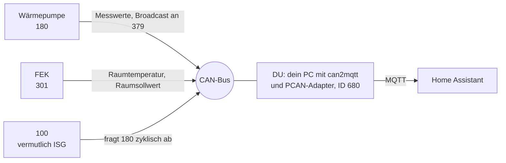

# can2mqtt für Stiebel Eltron

Liest und schreibt Werte einer Stiebel-Eltron-Wärmepumpe über den CAN-Bus und stellt sie per MQTT bereit, zum Beispiel für Home Assistant. Dieser Fork nutzt einen PEAK-PCAN-Adapter und ergänzt die Datenpunkte um alles, was an einer laufenden Anlage mitgeschnitten und geprüft wurde.

> **In short:** CAN to MQTT bridge for Stiebel Eltron heat pumps (Elster protocol). This fork adds verified write paths for DHW comfort and ECO temperature and the room setpoint, a decoded relay status (compressor on/off), and a guide to find more addresses with PCAN-View. Details are in German in [docs/stiebel-eltron-werte.md](docs/stiebel-eltron-werte.md).

## Was geprüft ist

Alles hier wurde mit PCAN-View an der Anlage mitgeschnitten und nachgestellt.

| Was | Richtung | Stand |
|---|---|---|
| Warmwasser Komfort | schreiben | geprüft |
| Warmwasser ECO | schreiben | geprüft |
| Raum-Soll Tag (an den FEK) | schreiben | geprüft |
| Relaisstatus mit Verdichter, Heizen und Warmwasser | lesen | geprüft, Bits aus fünf Beobachtungen abgeleitet |
| Raum-Soll Nacht (ECO) | schreiben | nicht getestet |

## Werte schreiben

`<MqttTopic>` ist der Wert `MqttTopic` aus deiner `config.json`, `MqttAcceptSet` muss auf `true` stehen.

| Was | Topic | Beispiel | CAN-Frame | Ziel |
|---|---|---|---|---|
| Warmwasser Komfort | `<MqttTopic>/dwh/temperature/day/set` | `49` | `30 00 FA 00 13 01 EA` | Wärmepumpe 180, Index `0013` |
| Warmwasser ECO | `<MqttTopic>/dwh/temperature/eco/set` | `41` | `30 00 FA 0A 06 01 9A` | Wärmepumpe 180, Index `0A06` |
| Raum-Soll Tag | `<MqttTopic>/room/hc1/temperature/day/set` | `22` | `60 01 FA 00 05 00 DC` | FEK 301, Index `0005` |

Die Anlage bestätigt Schreibzugriffe nicht. Ob ein Wert angekommen ist, siehst du nur durch Zurücklesen mit `.../read` oder am Gerät.

**Nicht auf `/dwh/temperature/desired` schreiben.** Das ist der aktuell wirksame Warmwasser-Sollwert (Index `0003`). Die Anlage setzt ihn laufend selbst, ein Schreiben bleibt wirkungslos. Zum Ändern den Komfortwert nehmen.

## Verdichter und Betriebsart lesen

Der Relaisstatus (`<MqttTopic>/status/relaystatus`) ist ein Bitfeld, das die Anlage selbst sendet:

| Bit | Bedeutung |
|---|---|
| `0x0C` (8 + 4) | Verdichter läuft |
| `0x20` | Heizbetrieb |
| `0x10` | Warmwasserbetrieb |
| `0x100` | Wärmeanforderung |
| `0x40` | immer gesetzt |

Beobachtet wurden `0060` (Ruhe), `0160` (Anforderung), `016C` (Verdichter heizt) und `015C` (Verdichter macht Warmwasser).

Beispiel für einen Home-Assistant-Sensor (nicht getestet):

```yaml
mqtt:
  binary_sensor:
    - name: "Verdichter läuft"
      state_topic: "heating/status/relaystatus"
      value_template: "{{ 'ON' if (value | int) | bitwise_and(12) == 12 else 'OFF' }}"
```

## Was am Bus passiert



Du bist in diesem Bild der Teilnehmer mit der ID `680`: dein PC mit PCAN-Adapter, auf dem can2mqtt läuft. Auch deine Testframes aus PCAN-View gehen mit dieser ID raus. Alle anderen Teilnehmer sind Geräte der Anlage.

Aufbau eines Frames:

```
60 01 FA 00 05 00 DC
|  |  |  |     |
|  |  |  |     +-- Wert, 16 Bit (0x00DC = 220 = 22,0 °C)
|  |  |  +-------- Index (0005)
|  |  +----------- FA = erweiterter Index
|  +-------------- Rest der Empfängeradresse
+----------------- oben Empfänger-Bereich, unten Typ (0 schreiben, 1 lesen, 2 Antwort)
```

## Loslegen

1. `can2mqtt_core/config-sample.json` nach `config.json` kopieren und anpassen: MQTT-Server, `CanSenderId`, `MqttTopic`, `MqttAcceptSet`.
2. Mit `dotnet build` bauen und starten.
3. Die Datenpunkte liest das Programm beim Start aus `./translator/stiebel_eltron/StiebelEltron.json` im Ausgabeordner. Ein Build kopiert die Datei nicht unbedingt dorthin. Nach Änderungen prüfen und neu starten.

## Weitere Adressen finden

Mit PCAN-View: Trace starten, genau eine Einstellung am FEK oder im ISG ändern, speichern und das Schreib-Frame (Typ `0`) suchen. Die Schritt-für-Schritt-Anleitung und alle Hinweise stehen in [docs/stiebel-eltron-werte.md](docs/stiebel-eltron-werte.md).

Wenn du eine neue Adresse gefunden hast, ergänze sie in `StiebelEltron.json`. Bitte schreibe dazu, was du geprüft hast und was nicht.
